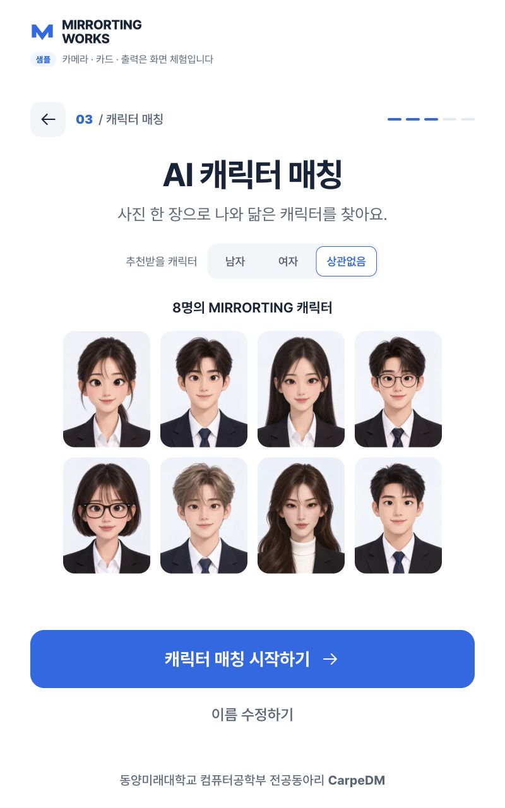

# 캐릭터 추천 조건 · 2026-10-13

## 구현

- SCR-06에 남자/여자/상관없음 버튼을 추가했다. 기본 상관없음이며 높이 48px, 선택 테두리와 aria-pressed, 키보드 포커스를 제공한다.
- 캐릭터 설정은 여자 01/03/05/07, 남자 02/04/06/08이다. 방문자의 성별을 추정하지 않는다.
- 조건별 미리보기와 분석 연출은 4명/8명이다. 실제 API는 같은 후보 안에서 점수 최대값을 추천한다.
- 재촬영·이름 수정은 선택을 유지하며 새 방문자 초기화는 any로 복원한다. 등록/DB 계약은 추가하지 않는다.
- 직접 캐릭터 선택은 기존 8명을 유지한다. 샘플 결과도 조건에 맞는 고정 캐릭터를 사용한다.
- 모듈·CSS 캐시 버전은 20261013-character-gender-r1로 갱신했다.

## 수정 파일

- backend/app.py, assets/characters/genders.json
- frontend/js/content.js, state.js, views.js, app.js, api-client.js, ui-preview.js
- frontend/js/camera.js, digital-badge.js: 공유 모듈 캐시 버전 동기화만 변경
- frontend/styles/kiosk.css, frontend/kiosk.html, frontend/ui-preview.html
- tests/test_character_preference.py, tests/frontend/character-preference.test.mjs
- README.md, docs/API_CONTRACT.md, docs/SCREEN_DEFINITION.md, docs/DECISIONS.md
- 이 검증 문서와 character-preference-800x1280.jpg

## 검증 결과

- npm test: 70 passed. 조건 상태/초기화, 설정 일치, multipart 전송, 샘플 조건별 결과와 기존 프런트 회귀를 확인했다.
- .venv/bin/python -m pytest tests/test_character_preference.py tests/test_face.py tests/test_api_flow.py -q: 41 passed, 1 skipped, 기존 Starlette/httpx 경고 1개.
- 제외된 후보가 최고 점수인 경우에도 해당 조건의 최고 점수를 선택하며, 잘못된 조건은 422, 후보 설정이 비었으면 503으로 실패한다.
- 실제 로컬 8002 서버의 공개 캐릭터 기준 사진 8장 × 조건 3개 = 24건. 모두 로컬 엔진으로 계산한 조건별 최고 점수와 일치했다.
- 800×1280 샘플 실제 클릭: 세 조건 전환, 4/8명, 높이48px, 시작 CTA/이름 수정/풋터 표시, 가로 넘침 없음.
- 샘플 남자 선택 → 촬영 → 결과 char_02 → 재촬영 → 이전 단계: 남자 선택 유지.
- 실제 웹 미리보기에서 390×844, 768×1024: 가로 넘침 없음, 선택 및 후보 변경 확인. 모바일은 기존 세로 스크롤을 사용한다.
- UI 미리보기의 분석 오류 상태: 재촬영 안내 및 재시도/처음으로 표시 확인. 실제 카메라 권한이나 장치 오류를 발생시킨 검증은 아니다.
- git diff --check, Python compileall, 변경 JS 구문 검사를 통과했다.

## 실행 상태와 한계

확인한 로컬 키오스크만 같은 127.0.0.1:8002에서 재시작했다. 기존 disabled NFC와 screen 프린터 모드를 유지했다. 다른 EXPO 서버는 변경하지 않았다.

독립 스타일 분리도 테스트 1개는 기존 표본 부족으로 skip이다. 추천 조건은 후보 범위를 제한하며 얼굴 모델의 닮음 정확도를 개선하거나 방문자의 성별을 판단하지 않는다. 실제 관람객·Pi 카메라·NFC·감열 출력은 이번 검증 범위에 포함하지 않았다. 커밋/푸시는 수행하지 않았다.
