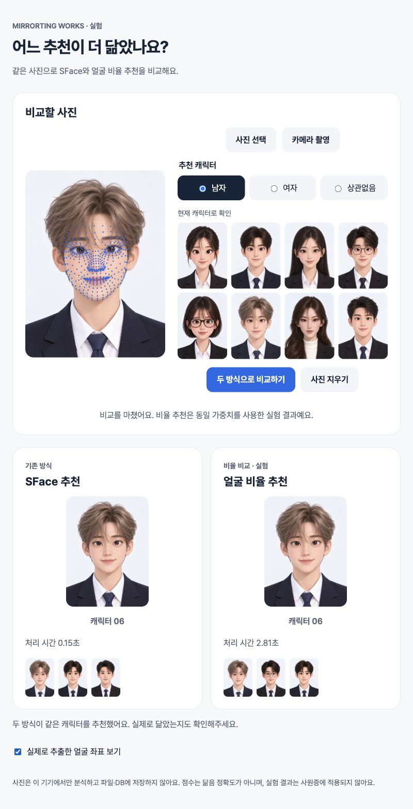

# MediaPipe 얼굴 비율 실험 검증

## 구현 파일

- backend/face_ratios.py: 478개 실제 좌표·9개 비율·정면 품질·유효성·조건별 거리 추천
- backend/ratio_lab.py, backend/app.py: 로컬 비교 API·설치 상태·동시1개·30초 제한
- scripts/build_face_ratios.py, ratio_frame.py, fetch_landmark_model.py, evaluate_face_ratios.py
- assets/face_ratios.json: 공개 캐릭터8명의 기준과 해시
- requirements-landmarks.txt, .gitignore, .env.example: 별도 환경과 명시적 실험 설정
- frontend/matching-lab.html, frontend/styles/matching-lab.css, frontend/js/matching-lab.js, matching-lab-core.js
- tests/test_face_ratios.py, tests/frontend/matching-lab.test.mjs
- README.md, docs/API_CONTRACT.md, docs/DECISIONS.md, docs/FACE_RATIO_EXPERIMENT.md 및 이 검증 문서/스크린샷

## 실제 확인

- 기존 키오스크 환경은 OpenCV4.14/NumPy2.5.3 유지. 새 별도 환경은 MediaPipe0.10.21/OpenCV4.11/NumPy1.26.4이며 pip check 통과.
- 공개 캐릭터8명 모두 단일 얼굴·478개 좌표·9개 비율 추출. 원본/반전/밝기±20%32/32 자기 추천 통과.
- 인물별 한 장의 공개 LFW128명, 다중 얼굴17건/정면 검사 거부9건 제외 후102명 비교. ratio07=44/08=45/06=12/05=1; 07/08 합계87.3%. SFace8종 사용. 두 추천 일치22/102. 닮음 정확도 판정이 아니다.
- 결과는 상위 output/ratio-comparison-20261013/evaluation.json에 집계만 저장. 실사 사진/좌표/개인별 결과를 새로 저장하지 않음.
- 실제8002 API의 캐릭터01/06/08 × any/male/female9건: 성공,478개 좌표, 두 추천 모두 조건 내 후보, 각4명/8명 순서 확인. api-validation.json은 공개 캐릭터 진단만 기록.
- 최종 서버 브라우저06남자: SFace06, 비율06, 후보 순서 차이 확인. 비율 API2.81초 관측(프로세스/모델 기동 포함).
- 실제 좌표 보기 체크 시 캔버스 표시 및 얼굴 위치 정렬 확인.
- 얼굴 없는 합성 흰 사진 업로드·비교: 얼굴 없음 안내, 결과 없음. 실제 카메라 권한·하드웨어 촬영은 실행하지 않음.
- 800×1280과390×844: 가로 넘침 없음. 모바일 추천 조건 터치48px, 결과 카드1열. 실험 화면은 세로 스크롤을 사용한다.
- 관련 pytest52 passed/1 skipped/기존 Starlette 경고1. 추가 기준 무결성 변경 후 해당11 tests 재통과. 프런트73 passed.
- 존재하지 않는 평가 데이터 디렉터리는 exit2로 거부. compileall, JS 구문 검사, git diff --check 통과.
- 같은8002로 비교 실험만 활성화했다. NFCdisabled/screen프린터와 기존 입사SFace를 유지했다. 기존 미커밋 변경을 보존했고 커밋/푸시는 하지 않았다.

## 판단

실험 구현과 로컬 실행은 확인했지만 비율 방식의 실사 선택 쏠림이 크다. 운영 교체를 하지 않는다. 실사/캐릭터 스타일 보정과 사람의 닮음 평가가 다음 단계다. Pi/ARM 패키지 설치·카메라·지연·물리장치는 미검증이다. 기존 skip1개는 SFace 독립 스타일 표본 부족이다. 이번 요청에서 ImageGen 생성이나 캐릭터 교체는 하지 않았다.
