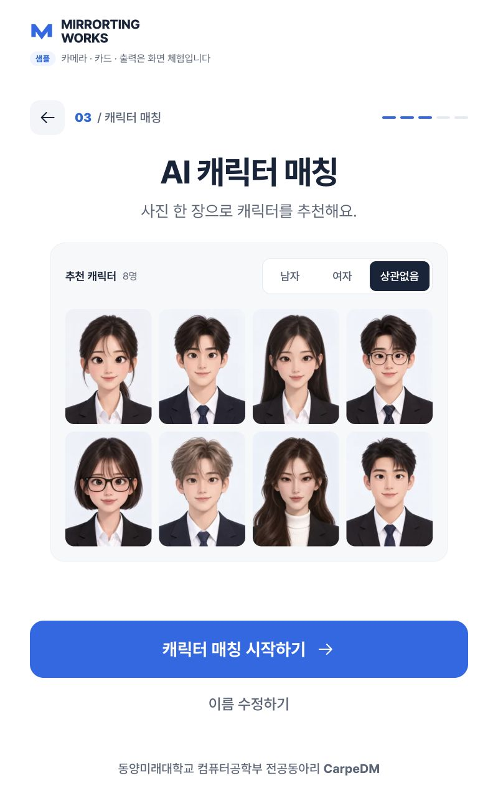
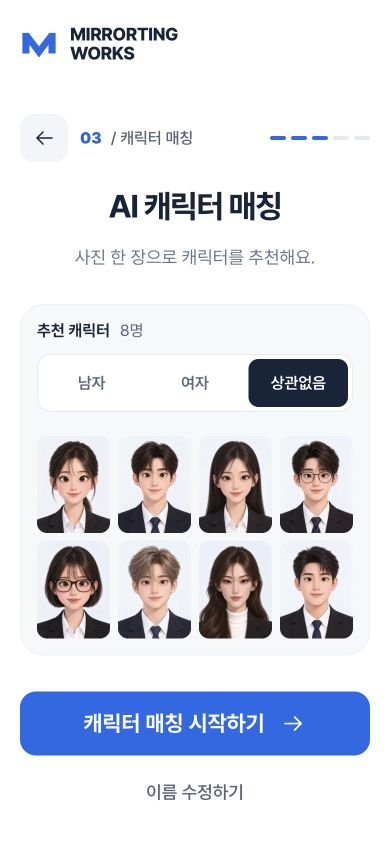

# 캐릭터 매칭 UI 정리 · 2026-10-13

## 이번 변경

- SCR-06의 추천 조건·인원·사진을 하나의 연한 회색 패널로 묶었다.
- 반복된 큰 `8명의 MIRRORTING 캐릭터` 제목을 `추천 캐릭터 · 8명/4명` 헤더로 정리하고 부제를 짧게 다듬었다.
- 선택 버튼은 흰색 세그먼트·네이비 선택 상태, 시작 버튼은 기존 파란색으로 표시한다. 조건 버튼 높이는 48px이며 포커스와 aria-pressed를 유지한다.
- 사진은 4열, 동일 간격·모서리로 정렬한다. 모바일 조건은 패널 안의 전체 폭 한 줄로 배치한다.
- 기존 남자/여자/상관없음 추천·샘플·상태·초기화 동작은 유지한다. 이번 요청에서 백엔드와 기준 이미지는 수정하지 않았다.

## 수정 파일

- frontend/js/views.js
- frontend/styles/kiosk.css, frontend/styles/web.css
- frontend/kiosk.html, frontend/ui-preview.html, frontend/js/app.js, frontend/js/ui-preview.js: UI/CSS 캐시 버전 갱신
- tests/frontend/kiosk.test.mjs: 변경된 제목·인원 표기 검사 갱신
- DESIGN.md, docs/SCREEN_DEFINITION.md, README.md 및 이 문서와 스크린샷

## 검증

- npm test: 70 passed. 새 문구와 기존 조건·API 전송·초기화·결과 선택의 프런트 회귀를 확인했다.
- node --check frontend/js/views.js, git diff --check 통과.
- 실제 800×1280 샘플 화면: 조건 버튼 48px, 가로 넘침 없음, 시작 버튼 하단1090px < 풋터 시작1192px. 패널/버튼/풋터 겹침 없음.
- 남자/여자/상관없음 클릭: 4명/4명/8명 사진과 선택 상태를 확인했다.
- 390×844 실제 웹 미리보기: 패널350px, 버튼 각각 약99px×48px, 가로 넘침 없음. 기존 세로 스크롤을 유지한다.
- 768×1024 실제 웹 미리보기: 남자 선택 및 4명 사진, 가로 넘침 없음.
- UI 미리보기 loading 상태에서 조건 버튼3개 비활성 확인 후 default로 복원했다.
- 캐시 버전20261013-matching-clean-r2로 사용자 미리보기를 새로고침했다. 검증용 임시 탭은 닫고 화면 크기 오버라이드는 해제했다.

## 범위

브라우저/UI 소프트웨어 검증이며 실제 방문자 사진·Pi 터치·NFC·프린터를 새로 검증하지 않았다. 백엔드 테스트는 이번 UI 변경에서 반복하지 않았다. 기존 미커밋 작업을 유지했으며 커밋/푸시는 하지 않았다. 이전 추천 조건 검증의 파란 테두리/분리된 헤더 시각 기록보다 이번 스크린샷과 DESIGN.md를 우선한다.
